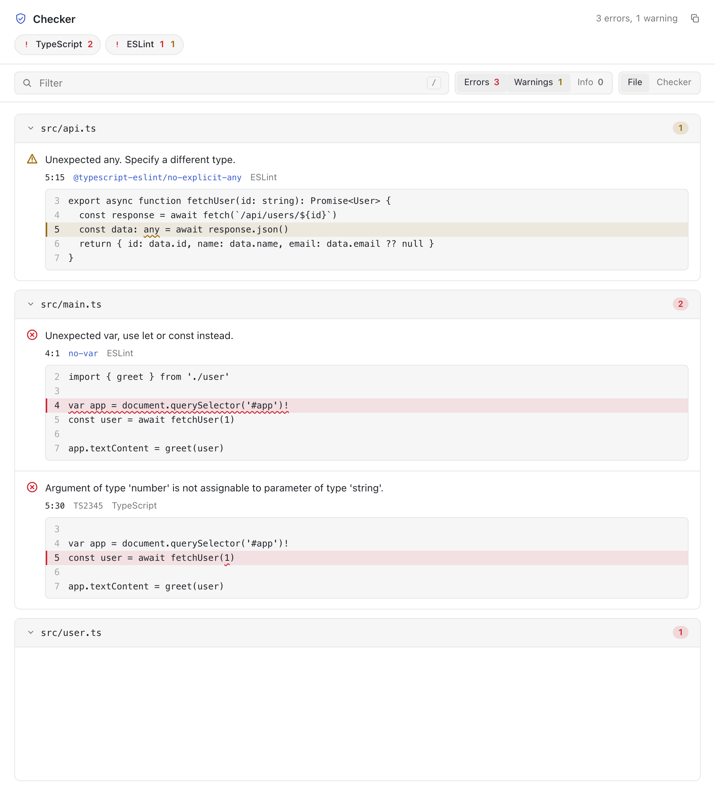

# vite-plugin-checker

[](https://www.npmjs.com/package/vite-plugin-checker)
[](https://www.npmtrends.com/vite-plugin-checker)
[](https://github.com/fi3ework/vite-plugin-checker/actions/workflows/ci.yml)

A Vite plugin that runs TypeScript, vue-tsc, svelte-check, ESLint, Biome, oxlint, and Stylelint in worker threads. It reports problems in the terminal and in a browser overlay while you develop, and fails `vite build` when a check fails.

<p align="center">
  <picture>
    <source media="(prefers-color-scheme: dark)" srcset="https://raw.githubusercontent.com/fi3ework/vite-plugin-checker/main/docs/public/screenshots/diagnostics-page-dark.png">
    
  </picture>
</p>

## Quick start

Install the plugin and the checker you want to use:

```bash
npm install -D vite-plugin-checker typescript
```

Add it to your Vite config:

```ts
// vite.config.ts
import { defineConfig } from 'vite'
import checker from 'vite-plugin-checker'

export default defineConfig({
  plugins: [checker({ typescript: true })],
})
```

## Documentation

See the [documentation](https://vite-plugin-checker.netlify.app) for every checker, the overlay options, and recipes for Nuxt, Vitest, and backend integrations. Upgrading from 0.x? Read [Migrating to v1](https://vite-plugin-checker.netlify.app/guide/migration).

The [`playground` directory](https://github.com/fi3ework/vite-plugin-checker/tree/main/playground) has an example project for each checker.

## License

MIT License © 2022 [fi3ework](https://github.com/fi3ework)
